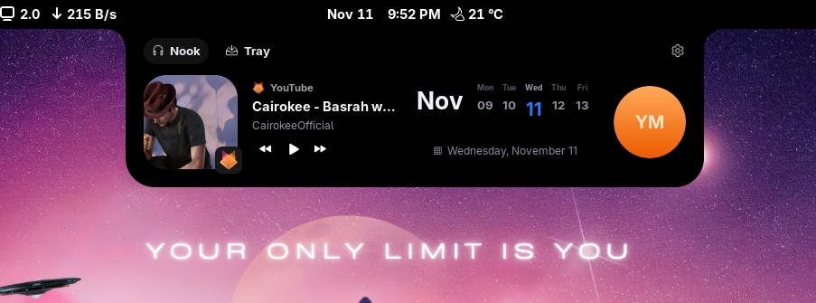
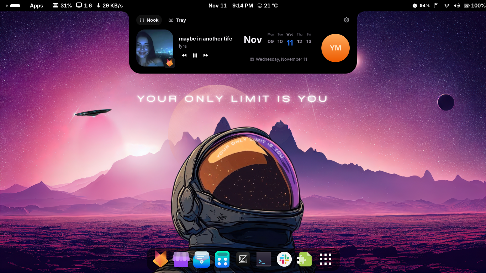

# Dynamic Island for GNOME 50

A compact music island that expands into a black, top-attached dashboard with playback controls, cover art, and a live date strip.

This is Yassine Mathlouthi's GNOME 50 fork of [Dynamic Island by basskibo / Bojan Jagetic](https://github.com/basskibo/linux_dynamic_island), based on upstream version 3.4.

## Screenshots

### Compact island


### Expanded dashboard



### Desktop overview



## What's new in this fork

- **GNOME Shell 50 support**, including its updated volume/brightness OSD API.
- **Attached notch dashboard:** pure-black background, inward-curved top shoulders, rounded lower corners, and a Nook/Tray header.
- **Music controls:** large rounded cover art, bottom-right player badge, track/album/artist details, and previous/play-pause/next buttons.
- **Live date strip:** a five-day view centered on today, with today's date highlighted. Click the date summary or Tray to open GNOME's calendar/notifications.
- **Account tile:** uses the local account photo when available; clicking opens GNOME Camera if installed. It is not a live camera preview.
- **Configurable auto-hide:** defaults to 10 seconds. Song, playback, or action changes reveal the island again. Hovering pauses the countdown; leaving starts a fresh countdown.
- **Cover-art launcher:** after the island fully hides, a small circular cover appears immediately right of the top-bar clock. Hover or click to reopen the expanded dashboard.
- **Smoother transitions:** shorter hover delays, cached styles, fewer redundant layout rebuilds, and no simultaneous resize during auto-hide.

The original MPRIS media support (Spotify, supported browsers, and other players), configurable positions/visualizers, and battery, Bluetooth, recording, and progress sources remain available.

## Compatibility

- This fork targets **GNOME Shell 50**; it does not advertise compatibility with older Shell versions.
- Developed on **GNOME Shell 50.6 / Wayland**. Other distributions and panel-extension combinations may need additional verification.
- The date strip shows local dates, **not calendar event data**.
- Media integration depends on the application exposing MPRIS. Some browser players may not provide cover art; the clock launcher then uses an audio icon.

> This fork keeps the upstream UUID, `dynamic-island@bjagetic`. Installing it replaces an existing installation with that UUID; the two versions cannot be enabled side by side.

## Build and install

You need GNOME Shell 50, the `gnome-extensions` command, and GLib's schema compiler (`glib-compile-schemas`). No Python environment is needed to build or run the extension.

```bash
git clone https://github.com/yassine-mathlouthi/linux_dynamic_island.git
cd linux_dynamic_island
./pack.sh
gnome-extensions install --force dynamic-island@bjagetic.shell-extension.zip
```

**Log out and back in** so GNOME discovers the newly installed extension. Then enable it:

```bash
gnome-extensions enable dynamic-island@bjagetic
```

Open settings:

```bash
gnome-extensions prefs dynamic-island@bjagetic
```

For the screenshot layout, select **top-center** positioning and **hover** expansion.

### New feature settings

All of these apply live from the extension preferences:

| Section | Setting | Default |
| --- | --- | --- |
| Auto-hide | Enable / disable; countdown from 1–300 seconds | On, 10 seconds |
| Clock-side cover launcher | Enable / disable; circle diameter from 12–28 pixels | On, 20 pixels |
| Expanded dashboard | Show / hide date strip, account / Camera tile, and Nook / Tray header independently | All on |
| Interface animations | Enable / disable; speed from 25–200% (higher is faster) | On, 100% |

The cover launcher appears only after auto-hide, so turning auto-hide off also keeps the launcher hidden. Hiding the dashboard header does not prevent opening preferences with the command above. Interface transitions also respect GNOME’s system-wide animation setting; the music visualizer and optional vinyl spin remain separate effects.

### Updating after code changes

```bash
./pack.sh
gnome-extensions install --force dynamic-island@bjagetic.shell-extension.zip
```

On Wayland, log out and back in to load changed JavaScript reliably. Preferences changes apply without a logout.

### Disable or uninstall

```bash
gnome-extensions disable dynamic-island@bjagetic
gnome-extensions uninstall dynamic-island@bjagetic
```

## Credits and licensing

Original extension: [basskibo/linux_dynamic_island](https://github.com/basskibo/linux_dynamic_island), by Bojan Jagetic and upstream contributors. GNOME 50 dashboard, auto-hide, cover launcher, and animation changes are maintained in this fork by [Yassine Mathlouthi](https://github.com/yassine-mathlouthi).

The upstream checkout did not include a project-level license when this fork was prepared. This fork does not add or imply a license for upstream code; clarify permissions with the original author before further redistribution or reuse. Third-party assets shown in screenshots belong to their respective owners.
